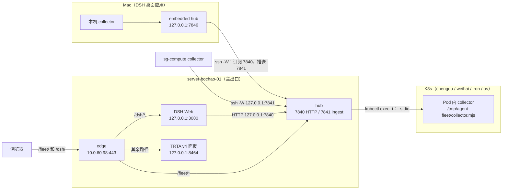

# DeepSeek Harness × TokenRouter 插件包

这个目录里是一组 DeepSeek Harness（DSH）插件和一个 skill。装好后，DSH 可以：

- 把 Mermaid 代码块直接渲染成图；
- 通过 ACP 或各家的原生协议接入 Claude Code、Codex、Oh My Pi，并在同一个工作区里继续它们的原生会话；
- 在每个会话旁边打开 Agent DAG 面板（整个会话家族的时间线、用量和 Context）；
- 用一张实时视图看本机、服务器和各个集群上的所有 agent 会话、子代理、它们启动的 agent，以及它们碰过的 Pod 和文件（Agent Fleet）；
- 让各个 code agent 共用同一套 skills。

所有插件都按 DSH profile 级 bundle 安装，适用于该 profile 下所有工作区的所有会话。实测环境是 DSH `0.2.1-rc.2`（Desktop 与 `dsh web` 两个 profile），macOS arm64；本分支的仓库代码基于上游 `0.2.1-rc.3`，插件不依赖仓库里的 DSH 源码。

| 目录 | 包名 | 用途 | 依赖 |
|---|---|---|---|
| `plugins/dsh-mermaid-pele` | `@local/dsh-mermaid-pele` | 在聊天里把 ` ```mermaid ` 代码块渲染成跟随主题配色的 SVG | 无 |
| `plugins/dsh-acp-adapter` | `@local/dsh-acp-adapter` | 把 Claude Code / Codex / Oh My Pi 接入 DSH，走 ACP 或各家的原生协议（基于 `@zaimokuza/dsh-acp-adapter` 的 fork） | 各 agent 的 CLI |
| `plugins/dsh-agent-dag` | `@local/dsh-agent-dag` | 原生会话导入、两级模型选择器、Agent DAG 页签、用量统计条、复制会话 ID、共享 skills、会话日志修复工具 | `dsh-acp-adapter`；Agent DAG 页签另需 Paseo `agent-dag` 面板服务 |
| `plugins/dsh-agent-dag/telemetry` | `@tokenrouter/dsh-telemetry` | Agent DAG 的子插件：把会话结构（不含内容）上报给 TokenRouter，控制台「会话树」靠它重建代理树。随 agent-dag 一起安装 | 模型请求走 TokenRouter，或设置 `TOKENROUTER_API_KEY` |
| `plugins/dsh-agent-fleet` | `@local/dsh-agent-fleet` | 多机、多集群的 Agent 实时监控：DSH / Claude Code / Codex / Oh My Pi 的会话、子代理、ACP 子代理、跨主机启动的 agent，以及它们碰过的 Pod 和文件；自带面板和 `agent_fleet` 模型工具 | 无（纯 JavaScript，Node ≥ 22.15）；可选 `kubectl`、`ssh` |
| `skills/mermaid-diagrams` | — | 结构类图（流程、时序、状态、ER、类、甘特、思维导图）优先输出 Mermaid 代码块；截图、照片、数据图表、界面草图等仍用正常图片输出 | 配合 `dsh-mermaid-pele` |
| `install.mjs` | — | 把上面的插件以 `link:` 依赖装进某个 DSH profile | Node ≥ 22、pnpm、npm |

## 快速安装

```bash
cd deploy/deepseek-harness-tokenrouter

# 1. 装进 Desktop profile（Web 用 --profile web）。--plugins 默认三个都装，agent-dag 会连同会话遥测子插件一起装；
#    --skill 同时安装 mermaid skill
node install.mjs --profile desktop --skill

# 2. 写入 ACP agent 路由和 Agent DAG 配置（只有用 acp / agent-dag 时才需要，见下文）
node plugins/dsh-agent-dag/configure.mjs --desktop \
  --panel-token-file <paseo-agent-dag>/plugins/agent-dag/.cache/web/token

# 3. Agent Fleet（可选，见下文）。Desktop 用 embedded：hub 跑在 DSH 进程里，跟随服务器的 hub；
#    桌面 hub 要一份服务器 hub 的 token 副本，推 collector 时还要 ingest token 的副本
node install.mjs --profile desktop --plugins fleet
node plugins/dsh-agent-fleet/configure.mjs --profile desktop --mode embedded \
  --ssh-target bochao_li@10.0.60.98
ssh bochao_li@10.0.60.98 'cat ~/.config/agent-fleet/token' > ~/.config/agent-fleet/upstream-token
ssh bochao_li@10.0.60.98 'cat ~/.config/agent-fleet/ingest-token' > ~/.config/agent-fleet/upstream-ingest-token
chmod 600 ~/.config/agent-fleet/upstream-token ~/.config/agent-fleet/upstream-ingest-token

# 4. DSH Web（服务器）：同一个插件、remote 模式，连本机 127.0.0.1:7840 的 hub
node install.mjs --profile web --plugins fleet
node plugins/dsh-agent-fleet/configure.mjs --profile web --mode remote

# 5. 完全退出 DSH 再打开（dsh web 则重启进程），然后刷新一次 Web GUI
```

`--plugins` 默认只装 mermaid、acp、agent-dag；`fleet`（Agent Fleet）要单独选，或者写 `--plugins mermaid,acp,agent-dag,fleet` 全装。它没有构建步骤，装好后再用 `plugins/dsh-agent-fleet/configure.mjs` 写它那一行配置。

`install.mjs` 按包目录找插件，所以 Web 那一步要在有这份目录的机器上跑。服务器上的部署方式不同：`deploy/deploy-server.sh sync` 把插件放到 `~/agent-fleet/dsh-agent-fleet`，`web` profile 直接 link 这个目录（`@local/dsh-agent-fleet`，装一次就固定）。profile 里已经有这条 link 时，只写配置：`cd ~/agent-fleet/dsh-agent-fleet && node configure.mjs --profile web --mode remote`；之后更新插件只用 `sync` + `units`，见下文「服务端部署」。

`install.mjs` 依次做这几件事：

1. 插件还没构建时先构建：`dsh-acp-adapter` 执行 `pnpm install --frozen-lockfile && pnpm build`，`dsh-agent-dag` 执行 `npm ci --omit=dev`。
2. 备份 `~/.dsh/profiles/<profile>/package.json`，写入 `"<包名>": "link:<绝对路径>"`，并加进 `dsh.profile.bundles`。fork 会替换掉已安装的 `@zaimokuza/dsh-acp-adapter` bundle。装 agent-dag 时同时写入会话遥测子插件 `@tokenrouter/dsh-telemetry`；之前用 tgz 装过的同名插件会被替换成这里的版本。不想上报遥测时加 `--no-telemetry`。
3. 在 profile 目录里执行 `pnpm install`。

插件是 link 进去的，所以之后改了这个目录、重新构建，重启 DSH 就会生效。先看会改什么可以加 `--dry-run`；只装其中一部分用 `--plugins mermaid` 或 `--plugins mermaid,acp`。设置了 `DSH_HOME` 时，脚本改的是那个 home 下的 profile。

卸载：在 DSH「插件」页停用，或者把对应包从 profile 的 `dsh.profile.bundles` 和 `dependencies` 里删掉，然后在 profile 目录重新执行一次 `pnpm install`。

---

## dsh-mermaid-pele：Mermaid 图渲染

**用途。** 聊天里所有 info string 是 `mermaid`（或 `mmd`）的代码块，都会用 [Pele](https://pele.run)（MIT，渲染 Mermaid 语法）原地渲染成 SVG：

- 图下方有「查看源码 / 查看图」可以来回切换，原文一直保留在 DOM 里；
- 代码块还在流式输出、或者语法有错时，照常显示代码块，不会报错弹窗；
- 不加载外部资源（`links: false, images: false`），图里只有形状和文字；
- 配色从 DSH 的 `--dsw-*` 设计变量映射到 Pele 的 `--pele-*` 变量，所以跟随亮色和暗色主题。

**使用。** 安装后不需要任何配置。模型回复里出现 ` ```mermaid ` 代码块就会显示成图。调试时在浏览器控制台执行 `window.__DSH_PELE_DEBUG = true` 再刷新页面。

**开发。** 改 `src/body.js`，然后运行 `node tools/build.mjs` 重新生成 `client.js`。不要重新缩进 `vendor/pele.global.js`，它里面多行模板字符串的缩进对解析器有意义。DOM 行为测试：`npm i jsdom` 之后运行 `node tools/dom-test.cjs`。详见 `plugins/dsh-mermaid-pele/README.md`。

## skills/mermaid-diagrams：结构类图优先用 Mermaid

**用途。** 这是一个偏好，不是禁令。Mermaid 能画的结构类图（流程图、架构图、时序图、状态机、ER 图、类图、甘特图、思维导图），让模型直接输出 ` ```mermaid ` 代码块，由上面的插件渲染，不再用 ASCII 字符画或自己画一张同样内容的图片。Mermaid 画不了、或者本身就是「画面」的内容，照常输出图片：截图（页面、终端、测试结果等视觉证据）、照片和生成的图片、有真实坐标轴的数据图（如 matplotlib）、界面草图、版式、几何和地图，以及用户明确要图片或文件的时候。skill 里有一张「Mermaid 还是图片」的判断表，也有保证 Mermaid 能渲染的写法规则（短标签、给含特殊字符的标签加引号等）。图要放进报告、幻灯片、PR 这类不渲染 Mermaid 的地方时，既保留 Mermaid 源码，也另外生成 SVG/PNG 文件。

**使用。** `install.mjs --skill` 会把它复制到 `~/.agents/skills/mermaid-diagrams`；已有同名目录时不会覆盖。这个目录是所有 code agent 共用的 skill 根目录（见下文「共享 skills」），所以 DSH 自己的 agent 和通过 ACP 接入的 agent 都能用到。

## dsh-acp-adapter：ACP Agent 接入（fork）

**用途。** 在 DSH 的会话 UI 里，通过 Agent Client Protocol 或各家的原生协议（见下）驱动 Claude Code、Codex、Oh My Pi。原生会话、工具审批、团队协作的行为与上游 `@zaimokuza/dsh-acp-adapter` `v0.2.1-rc.2.3`（MIT）一致。这个 fork 加了下面几项（详见 `plugins/dsh-acp-adapter/FORK.md`）：

- **原生轨迹记录**：ACP 回合里的每次工具调用，都会按真实时间写进 DSH 会话日志（`tool/call` + `tool/result`）。Shell 结果里是真实输出：超长时截断到 64 000 字节，非零退出码会标出。回合的 token 用量也会记下。所以 Trajectory 页签不需要事后回填。
- **Chat 里每次工具调用只显示一张卡片**：日志里已经有原生工具行时，sidecar 里的同一次调用不再重复显示。
- **团队桥接默认关闭**：配置项 `teamBridge` 默认为 `false`，ACP agent 只能看到它自己的工具。设成 `true` 恢复上游行为（注入 `dshteam_*` MCP）。桥接关闭时，会话菜单里不再显示只管 DSH 工具的「DSH 工具审批」。
- **权限只有一个入口**：ACP 会话的输入框里，agent 自己的权限模式显示为「<Agent> permissions · <模式>」（Claude Code：Manual / Accept edits / Plan / Auto / Bypass permissions；Codex：Read-only / Workspace access / Auto review / Full access；Oh My Pi：Default / Plan），点开即可切换：新建会话时在发第一条消息之前就能选（例如 Claude Code 选 Bypass permissions、Codex 选 Full access），已有会话在 agent 未连接时也能改；所选模式保存在 sidecar，在下一条消息发出前应用到 agent 会话。DSH 自己的「Access mode」不约束 ACP agent（agent 进程不受 DSH 沙箱管理），所以选中 ACP agent 时隐藏。新会话的可选模式取自该 agent 最近一次会话报告的模式列表，所以每个 agent 至少要先用过一次。
- **分支保留谱系**：在 DSH 里对 ACP 会话「Branch into a new conversation」时，从最新一轮分出的会话走 ACP 原生 fork（继承上下文），从更早一轮分出的会话新开 agent 会话。两种情况下，新会话的模型请求都带 `x-tokenrouter-forked-from-session-id` 等请求头，网关会话树里能看到它挂在原会话下。三个 agent 分别由 `claude-launch.mjs`（`--settings` 层，不会被用户 `settings.json` 覆盖）、`codex-launch.mjs`（`http_headers`）、`omp-link-headers.js`（`omp acp -e` 扩展）把请求头加上。
- **斜杠命令与快捷交互**：原生传输下，Claude Code / Codex / Oh My Pi 各自的命令登记为 DSH 命令，输入 `/` 就能在菜单里看到，`/help` 列出全部命令和运行方式。`/btw`（Codex 另有 `/side`）旁路提问，主任务照常运行，答案只显示在 DSH，不进入 agent 对话；`/status`、`/context`、`/usage`、`/mcp`、`/tasks`、`/diff` 等不调用模型、立即返回；`/rewind` 回退文件和对话，`/goal` 使用各家原生的目标模式，`/clear`、`/new` 清空 agent 上下文（重启后也不会恢复），`/plan`、`/effort`、`/fast` 对应 agent 自己的设置；`/compact`、`/init`、`/review`、skill 和自定义命令照常作为一轮发给 agent；单独一行的 `!命令` 直接在 shell 执行；只能在终端用的命令返回说明，不会发给模型。三家逐个命令的支持情况见 `plugins/dsh-acp-adapter/docs/native-commands.md`。
- **提问卡片与运行中改设置**：agent 的提问（Claude Code `AskUserQuestion`、Codex `requestUserInput`、Oh My Pi `ask` 等）按原始选项显示为 DSH 问题卡片，支持自定义文字、多选和跳过；权限模式、协作模式、思考强度等可在 agent 运行中修改，作为待生效设置在下一轮开始前应用。
- **去掉了 ACP Diagnostics 会话页签**。宿主侧的诊断 API 和恢复面板保持不变。
- **没有可见文字的 `end_turn` 回合**：只要本回合有一次原生工具结果成功，就按「已完成」处理，不再报 `ACP_NO_VISIBLE_RESPONSE`。
- **原生传输**：团队桥接关闭（默认）时，agent 的启动命令是 Oh My Pi（`omp`）、Codex（`codex` / `codex-acp`）或 Claude Code（`claude` / `claude-agent-acp` / `claude-launch`），适配器直接用厂商的原生协议驱动 agent 进程（`omp --mode rpc-ui` 的 JSONL、`codex app-server` 的 JSON-RPC、Claude Code 的 stream-json），再以和各家 ACP 桥相同的会话 id、配置项 id、模式 id 和工具调用字段回报给 DSH 运行时。所以已有的 sidecar 绑定、已保存的权限模式和模型选择器照常可用，同时支持会话进行中途的引导消息（steer），并上报用量和上下文占用。其余命令，以及设了 `teamBridge: true` 的 profile（原生传输不承载 DSH 的 MCP 工具），仍走 ACP。选择逻辑见 `src/runtime/native/transports/contract.ts` 的 `selectNativeTransportKind` 和 `src/host/composition/installed-profile-registry.ts`，用例在 `test/native/`。

**使用。** 用 `install.mjs` 安装后，要在 profile 的 `cordis.patch.yml` 里给 `dsh-acp-adapter` 配置 `agents`，包括每个 agent 的启动命令、参数和 env。用 TokenRouter 时由 `configure.mjs` 生成（见下一节）。也可以按上游 README（`plugins/dsh-acp-adapter/README.md`）手写。配好后，在输入框的模型选择器里选 Claude Code / Codex / Oh My Pi 的模型就能开会话。

**开发。** 在 `plugins/dsh-acp-adapter` 目录里运行 `pnpm install --frozen-lockfile && pnpm build`（Node `^22.19 || >=24`）。单元测试用 `pnpm test`（原生传输的用例在 `test/native/`）。跟进上游版本的步骤见 `FORK.md` 的「Rebase procedure」。

## dsh-agent-dag：多 agent 会话、模型与 Agent DAG

**用途。** 这个插件分宿主端（`index.js`）和浏览器端（`client.js`）两部分：

| 功能 | 说明 |
|---|---|
| 原生会话导入 | 扫描 Claude Code（`~/.claude/projects`）、Codex（`~/.codex/sessions`、`archived_sessions`）、Oh My Pi（`~/.omp/agent/sessions` 等）的会话，通过 DSH 自己的持久化服务导入成 DSH v4 会话，放进对应目录的工作区，并记录 ACP 绑定。在 DSH 里继续这些会话时，接着写的就是原生 transcript。导入是幂等的：每个原生会话只对应一个 DSH 会话。刚出现两分钟内的原生会话不导入，留给 ACP adapter 绑定，避免分支、新会话被重复导入。 |
| 会话归属标记 | 侧边栏每个会话行和会话标题前，用 A / C / O / D 标明它属于 Claude Code / Codex / Oh My Pi / DeepSeek Harness。 |
| 复制 ID | 会话标题右侧有「复制 ID」（DSH 会话 ID）和「复制原生 ID」（ACP 绑定的原生 agent 会话 ID）两个按钮。 |
| 两级模型选择器 | 输入框的模型选择器先选 agent（DSH 本身或某个 ACP agent），再选该 agent 的模型和推理强度。切换 agent 或模型时，推理等级只在同一 agent 内保留，否则选该模型支持的 high / medium / low，避免把一个 agent 的等级带给不支持它的另一个 agent。 |
| Code agent 模型面板 | 在「设置 → 模型」和插件页里读写每个 agent 的默认主模型和子代理模型（DSH 的 profile patch、Claude 的 `settings.json`、Codex 的 `config.toml`、Oh My Pi 的 `config.yml`）。写之前先备份原文件；新会话生效。 |
| 用量统计条 | 输入框底部显示本会话家族的 token、缓存命中率、TTFT / 解码速度和费用。经 TokenRouter 的会话还会显示当前网关通道。 |
| Agent DAG 页签 | 会话的 Chat / Trajectory 旁边多一个 Agent DAG 页签，内嵌本机 Paseo `agent-dag` 面板（`http://127.0.0.1:6795/`）。面板里有时间线、结构、计划与约定、通信、用量、速率、工具、Context 几个页签，可以在新窗口打开。 |
| 共享 skills | `~/.agents/skills` 是所有 agent 共用的 skill 根目录。DSH、Codex、Oh My Pi 原生就读这个目录。Claude Code 只读自己的 `skills` 目录，所以插件把每个共享 skill 软链接过去：同名的已有目录不动，共享 skill 删除后，插件建的链接也会删掉。`cordis.patch.yml` 还让 DSH 自己的 agent 读取 `~/.claude/skills`、`~/.codex/skills`、`~/.omp/agent/skills`。 |
| 会话日志修复工具 | `repair-imported-logs.mjs`、`rebuild-imported-logs.mjs`、`refresh-binding-fingerprints.mjs`，见下文「维护脚本」。 |

**前置条件。**

- 已安装 `dsh-acp-adapter`。
- `configure.mjs` 从 Paseo 的 provider 配置 `~/.paseo/config.json` 里读取 `claude-tr` / `codex-tr` / `omp-tr` 三个 provider 的启动命令和 TokenRouter env（只读，不修改）。这三个 provider 由 [omgwowai/paseo-deploy](https://github.com/omgwowai/paseo-deploy) 的 local-mac 流程生成。
- 只有 Agent DAG 页签和网关通道显示需要 Paseo 的 `agent-dag` 插件在本机 `127.0.0.1:6795` 提供面板。它的访问 token 文件在 `<paseo-agent-dag>/plugins/agent-dag/.cache/web/token`。不装 Paseo 时，其他功能照常可用，页签里会显示不可用的原因。

**配置。**

```bash
node plugins/dsh-agent-dag/configure.mjs [--desktop] \
  [--panel-token-file <token 文件>] [--panel-url http://127.0.0.1:6795/]
```

- 不加 `--desktop` 时配置 `web` profile。
- 写入前把整个 profile 目录备份到 `$DSH_HOME/backups/`。
- 往 profile 的 `cordis.patch.yml` 写两条配置：`dsh-acp-adapter.agents`（三个 agent 的命令和 env；工具审批默认 `ask`）和 `dsh-agent-dag`（`tokenFile`、`panelUrl`、`externalRoots`、`nativeHomes`）。
- 文件权限设为 `0600`，因为 agent 的 env 里有 TokenRouter Key。
- agent 的 `PATH` 会去掉每个 shell 各不相同的临时目录，所以在哪个终端运行，结果都一样。
- token 文件也可以用 `AGENT_DAG_TOKEN_FILE` 环境变量指定；面板地址用 `AGENT_DAG_URL`。再次运行时，沿用 patch 里已有的值。
- 设置 `PASEO_AGENT_DAG_ROOT` 后，模型面板改默认模型时，会把新值同步写回 `<root>/config/models.json`（Paseo apply 的源）；不设置时，面板会提示下次 apply 可能把这个值还原。
- `--scratch` 配合一个隔离的 `DSH_HOME`，用于测试：生成隔离的 agent home，不碰真实的 `~/.claude` / `~/.codex` / `~/.omp`。

`dsh-agent-dag` 的其他配置项：

- `liveTools`：默认开启。开启时，回合结束后从原生 transcript 补写工具行。配合这个 fork 的 adapter 时应设为 `false`，因为 adapter 已经自己记录了。
- `sharedSkillsDir`：共享 skill 根目录，默认 `~/.agents/skills`。

**维护脚本。** 不加 `--apply` 时只报告，不改任何东西。加 `--apply` 时：先把原文件备份到 `--backup-dir`；再拿会话的 flock 锁，正在被 DSH 打开的会话会跳过；最后原子替换。

| 脚本 | 场景 |
|---|---|
| `repair-imported-logs.mjs [--apply --backup-dir D] [session-id…]` | 修复早期导入器写出、DSH 加载时报 `stored session … is corrupt` 的日志。两种情况：assistant 消息缺 `data.stream`，或者 `fallback` 标题的 `messageSeqs` 为空。导入后用户续写的事件原样保留。 |
| `rebuild-imported-logs.mjs [--apply --backup-dir D]` | 用当前导入器按原生 transcript 重建导入的会话日志。 |
| `refresh-binding-fingerprints.mjs --profile <patch> --sidecar <sidecar.sqlite> [--apply] [--adapter <dir>]` | agent 启动配置（命令、env、PATH）改了以后，重算 ACP 绑定里保存的启动指纹。否则继续旧会话时，adapter 会以 `profile-changed` 为由拒绝。脚本默认到 profile 的 `node_modules/@zaimokuza/dsh-acp-adapter` 里找适配器的指纹模块；装的是本目录的 fork 时加 `--adapter <profile>/node_modules/@local/dsh-acp-adapter`（需要已构建出 `lib/`）。 |

`meter.bundle.js`、`native.bundle.js` 是 Paseo `agent-dag` 插件服务端代码（会话读取、家族计算、计量）的构建产物，由那边的 `node dsh/build.mjs` 生成，不要手改。测试：`node --test tests/*.test.mjs`。

## 会话遥测：Agent DAG 的子插件

**用途。** `plugins/dsh-agent-dag/telemetry` 是 TokenRouter 的会话遥测插件 `@tokenrouter/dsh-telemetry`（0.3.2，与 TokenRouter 仓库 `clients/dsh-telemetry` 和网关文档站发布的 tgz 内容一致）。它把 DSH 会话的结构上报给 TokenRouter：主代理、子代理和分叉会话，每次模型调用（含失败和重试）、工具调用、MCP 调用、上下文压缩和错误。只上报结构和计时，不上报提示词、回复或工具输出。TokenRouter 用这些在控制台「请求详情 → 会话树」里重建整棵代理树，并把每次模型调用对到网关上的请求记录。它还会给发往 TokenRouter 的模型请求加上 `x-session-id` 请求头。

Agent DAG 在本机看会话家族，会话遥测让网关那边也能看到同一棵树，所以两者一起安装：`install.mjs` 装 agent-dag 时会把它作为单独的 DSH bundle 一并 link 进 profile，不需要再单独执行 `dsh plugin add`。

**配置。** 一般不用配：DSH 的模型请求发往 TokenRouter（`https://tokenrouterv2.omgwow.tech`）时，上报直接用这些请求自己带的 Key。其他情况用环境变量：

| 环境变量 | 作用 |
|---|---|
| `TOKENROUTER_API_KEY` | 模型请求不走 TokenRouter 默认地址时，上报用的 Key。不设置又不走 TokenRouter 时，插件只加请求头，不上报 |
| `TOKENROUTER_OTEL_URL` | 接收端地址，默认 `https://tokenrouterv2.omgwow.tech/v1/otel` |
| `TOKENROUTER_BASE_URL` | 模型请求实际使用的 TokenRouter 地址（例如内网地址），用于识别哪些请求要加请求头 |

查看结果：在 TokenRouter 控制台「请求详情」里打开这次会话的任意一条请求，看「会话树」。字段明细、接口和排障见 `plugins/dsh-agent-dag/telemetry/README.md`。

**范围。** 这个子插件只覆盖 DSH 自己的 agent。通过 ACP 接入的 Claude Code、Codex、Oh My Pi 是独立进程，它们的会话遥测由各 agent 自己的 TokenRouter 配套客户端负责（paseo-deploy 的 local-mac 流程会装好），本目录不安装那些客户端。

## dsh-agent-fleet：多集群 Agent 实时监控

**用途。** 一张实时视图，列出用户在每个站点上跑的所有 code agent 会话：DeepSeek Harness、Claude Code、Codex、Oh My Pi。每个会话显示状态、正在做什么、模型、token 用量和起止时间；关系上能看到主会话 → 原生子代理、DSH 会话 → ACP 子代理（Claude Code / Codex / Oh My Pi）→ 子代理自己的子代理，以及一个 agent 在别的机器或 Pod 上起的会话。同一张视图里还有这些 agent 碰过的 K8s Pod 和读写过的文件。数据来自各站点 collector 读到的原生会话文件和进程表，汇总到一个 hub；DSH 桌面应用和服务器上的 DSH Web 各有一个入口，模型还能用 `agent_fleet` 工具直接查。`plugins/dsh-agent-fleet/README.md` 是开发者文档，`CONTRACT.md` 是设计契约。

**站点。**

| 站点 | 机器 | 到 hub 的通道 |
|---|---|---|
| `mac` | 本机 Mac（DSH 桌面应用） | 桌面插件在 DSH 进程里跑一个 hub（`127.0.0.1:7846`）和本机 collector；同时用 `ssh -W` 订阅服务器 hub，并把本机 collector 推给它 |
| `server-bochao-01` | 10.0.60.98，跑 hub、DSH Web、edge | hub 进程内的 collector |
| `sg-compute` | 10.0.1.138 | 本机 collector 用 `ssh -W 127.0.0.1:7841 bochao_li@10.0.60.98` 推到服务器 hub |
| `chengdu` `weihai` `iron` `os` | 各集群 `mc-bochao-li` 命名空间里的 Pod | hub 用 `kubectl exec -i <pod> -- node /tmp/agent-fleet/collector.mjs --stdio` 拉取；chengdu / weihai 的 Pod 没有到服务器的出网，所以总是 hub 发起 |

**跟踪的内容。**

- 四种 agent 的每个会话：状态（`running` / `waiting` / `idle` / `done` / `error` …）、正在做的事、模型、token 用量、开始和结束时间。来源是各家自己的会话文件（`~/.claude/projects`、`~/.codex/sessions`、`~/.omp/agent/sessions`、`~/.dsh/sessions`）和进程表；额外的会话目录用 `--root kind=path` 或 `AGENT_FLEET_ROOTS` 加。
- 关系：主会话 → 原生子代理；DSH 会话 → ACP 子代理 → 该子代理自己的子代理。ACP 绑定从 DSH 的 `sidecar.sqlite` 读，父会话按原生会话 id 精确挂接。
- 跨主机 / 跨集群启动：agent 用 `kubectl exec <pod> -- omp …` 或 `ssh <host> claude …` 起的会话，按命令行的目标和时间窗挂到发起它的 agent 下面；带 `AGENT_FLEET_PARENT` 环境变量的按变量精确挂接。DSH 自己为 ACP 子进程设 `AGENT_FLEET_VIA=dsh:<会话 id>`（见 `dsh-acp-adapter` 的 `FORK.md`）。
- Pod：agent 碰过的 Pod 都会列出来（即使没有 collector），还能看它的容器、kube 事件和哪些调用碰过它。
- 文件：工具调用里出现的路径（读、写、改、搜）按主机和路径归并，可以点开预览。预览只读、脱敏，上限 256 KiB。

**面板。**

桌面应用和服务器的 DSH Web 里都有「Agent Fleet」侧边栏入口和一个会话页签，打开的是 hub 提供的同一个面板（iframe；token 放在 URL fragment 里）。

| 页签 | 内容 |
|---|---|
| Fleet | 站点 → 主机 / Pod → agent 树，跨主机的子节点标 `↗` |
| Timeline | 类似 Agent DAG 的甘特图：一条泳道一个 agent，工具调用按类别着色，带 spawn / return 连线 |
| Pods | 被 agent 碰过的 Pod，按站点分；相位、节点、容器、kube 事件、谁碰过 |
| Files | 被碰过的文件，按路径归并；点开是只读预览 |
| Feed | 整个 fleet 的工具调用实时流 |

面板的状态都在 URL hash 里（`#view=timeline&key=<agent key>`）；远程面板地址是 `http://10.0.60.98:443/fleet/`。插件打开面板时给的是 `/fleet/?nonce=…`（要定位会话时再加 `#focus=…`）：hub 把一次性 nonce 换成 HttpOnly cookie 并 302 到裸面板，所以原始 token 不进 URL、fragment 或页面存储。手动进入时仍然可以用 `#token=<token>`（只留在页面内存里，同样换成 cookie），`/?token=<token>` 也是一次性换 cookie。桌面应用用的是它自己 hub 的地址。

**延迟。** 实测（2026-10-31）：在各站点的会话文件里追加一行工具调用，到它出现在浏览器经 edge 订阅的 `/fleet/api/stream` 上，每个站点 60 个样本（时钟偏差已校正）：

| 站点 | p50 | p95 | 最大 |
|---|---|---|---|
| server-bochao-01 | 536 ms | 826 ms | 930 ms |
| sg-compute | 311 ms | 459 ms | 567 ms |
| chengdu Pod | 316 ms | 501 ms | 556 ms |
| weihai Pod | 294 ms | 483 ms | 566 ms |
| iron Pod | 308 ms | 489 ms | 535 ms |
| os Pod | 353 ms | 476 ms | 545 ms |
| mac | 347 ms | 718 ms | 894 ms |

面板 DOM 上看到同一条事件的时间（server-bochao-01，n=10）是 p50 297 ms、p95 586 ms。时间主要花在 collector 的 250 ms 合并窗口和 hub 的 200 ms 合并窗口上。服务器比其他站点慢 200–350 ms，原因是那台机器的会话目录太多，超过了 collector 的 2048 个 `fs.watch` 预算，新目录改走 500 ms 的轮询。

**实测覆盖（2026-10-31）。** 下面每一类都在真实站点上跑过，并在 hub 里核对过链接的类型和最终状态：

| 形态 | 站点 × agent | 链接 |
|---|---|---|
| 主会话 → 原生子代理 | 6 个站点（server、sg-compute、4 个 Pod）× 4 种 agent，共 24 格 | `file`，精确 |
| DSH → ACP 子代理 → 它的子代理 | server（Claude / Codex / OMP）、sg-compute（3 种）、4 个 Pod（各 3 种）、Mac（Claude） | `acp` 精确，然后 `file` 精确 |
| 跨主机 / 跨集群启动 | sg-compute claude → ssh → server codex；server DSH → kubectl → iron Pod omp；server codex → kubectl → weihai Pod dsh；Mac omp → kubectl → weihai Pod claude | `command`（推断，挂到具体工具调用 id），子代理 `file` 精确 |

**已知限制。**

- 服务器 hub 只加载最近 6 小时（`--since 6h`）写过的会话。一个跨主机启动的父会话如果早于这个窗口，子会话会作为根节点出现。
- 不带 `--context` 的 `kubectl exec` 不知道是哪个集群；四个集群里有同名 Pod 时，按开始时间最近的会话挂接。
- DSH headless profile 没有 `connection` 服务，装不上本插件，所以 headless 发起的跨主机启动只能按命令行推断（`command`），拿不到精确的工具调用 id。DSH Web 和桌面应用不受影响。
- DSH ACP adapter 每轮会起一次模型目录探测，留下 cwd 在 `dsh-acp-probe-*` 的短会话。它们标为 `probe` 角色，不挂到任何父会话，也不会被推断链接认领。

**`agent_fleet` 模型工具。** 装了插件后，DSH 里的模型可以直接查这些数据（只读，数据是几秒前的）。输出是一条摘要加紧凑 JSON（上限约 12 KB，列表超长时带 `more` 计数）。

| action | 用途 |
|---|---|
| `overview` | 主机 × agent 种类（运行中 / 总数）、主机连接状态、Pod 数、跨主机链接 |
| `list` | agent 列表，可按 `site` / `host` / `kind` / `status` / `role` / `text` / `since` 过滤 |
| `family` | 一个 agent 所在的整棵树（根、子代理、ACP 子代理、跨主机启动的 agent） |
| `agent` | 单个 agent 的记录和最近事件，可向前翻页 |
| `pods` / `pod` | 被碰过的 Pod 列表 / 单个 Pod 的容器、碰过它的调用和 kube 事件 |
| `files` / `file` | 文件清单（按 agent 或全部）/ 预览一个文件 |
| `query` | 按类别、目标类型、站点、关键字搜工具调用 |

**架构。**



hub 持有全部状态：它接收 collector 的 `hello` / `agent` / `events` / `heartbeat`，解析父子链接，维护一个带 `cursor` 的变更日志，并用 SSE（`/api/stream`）推给面板。collector 只读本机文件、不自己开网络连接：桌面和 sg-compute 用 `ssh -W`，Pod 用 hub 发起的 `kubectl exec`。桌面 hub 是完整 hub 的第二个实例，它订阅服务器 hub 并合并状态，所以桌面应用单独运行也能看本机，联网时看到整个 fleet。edge 是服务器上唯一的对外监听，按前缀转发。

**服务端部署。** 全部从本目录的 checkout 执行，目标是 `bochao_li@10.0.60.98`（`AGENT_FLEET_SERVER` 可覆盖）和 `sg-compute`（`AGENT_FLEET_SG`）。脚本会构建 collector bundle，不复制 `.scratch`、`node_modules`、`tests`。

```bash
cd deploy/deepseek-harness-tokenrouter/plugins/dsh-agent-fleet
deploy/deploy-server.sh sync       # 复制插件到 ~/agent-fleet/dsh-agent-fleet
deploy/deploy-server.sh units      # 渲染并（重）启动 hub 和 DSH Web 的 user unit
deploy/deploy-server.sh sg         # 复制到 sg-compute 并（重）启动它的 collector unit
deploy/deploy-server.sh edge-test  # 在 127.0.0.1:7849 起一个临时 edge，逐个探测路由
deploy/deploy-server.sh cutover    # 把 TRTA v4 面板挪到 127.0.0.1:8464，edge 接管 :443
deploy/deploy-server.sh rollback   # 撤销 cutover
deploy/deploy-server.sh status     # unit 状态 + 各健康检查地址
```

| 子命令 | 做什么 |
|---|---|
| `sync` | 本地构建 `dist/agent-fleet-collector.mjs`，再把插件 rsync 到服务器的 `~/agent-fleet/dsh-agent-fleet`，并确认服务器上的 `node` 版本和 bundle。 |
| `units` | 先写 `~/.config/agent-fleet/hub.env`（`AGENT_FLEET_ROOTS`，给 TRTA v4 分析容器里的会话用），再渲染 `agent-fleet-hub.service` 和 `dsh-web.service`，`daemon-reload` 后重启这两个 unit。 |
| `sg` | 用 tar 覆盖到 sg-compute 的 `~/agent-fleet/dsh-agent-fleet`，渲染 `agent-fleet-collector.service`（`--root` 指向 `~/agent-fleet/homes/<kind>`），重启该 unit。 |
| `edge-test` | 用 `agent-fleet edge --listen 127.0.0.1:7849` 代理现网 hub、DSH Web 和面板，打印三个路径的 HTTP 状态码，然后退出。改 edge 之前先跑它。 |
| `cutover` | 装系统 unit `agent-fleet-edge.service` 和 TRTA v4 面板的 drop-in（面板改听 `127.0.0.1:8464`），重启面板，启用并启动 edge，最后列出 443 / 8464 的监听。 |
| `rollback` | 停用 edge，删掉 drop-in，`daemon-reload` 并重启面板（回到 443），再列出 443 的监听。 |
| `status` | 打印 hub、DSH Web、edge、TRTA 面板和 sg-compute collector 的 unit 状态，以及各健康检查地址的 HTTP 状态码。 |

| Unit | 作用域 | 内容 |
|---|---|---|
| `agent-fleet-hub.service` | 服务器，`systemd --user` | `hub --listen 127.0.0.1:7840 --ingest 127.0.0.1:7841 --base /fleet --public-host 10.0.60.98 --token-file … --ingest-token-file … --kubeconfig … --since 6h`。jemalloc 预加载、`MemoryMax=4G`、`OOMScoreAdjust=500`：这台机器还跑 TRTA v4 作业，hub 必须小，并且在内存压力下先被内核选中、自己重启。日志 `journalctl --user -u agent-fleet-hub.service`。 |
| `dsh-web.service` | 服务器，`systemd --user` | `dsh --profile web --host 127.0.0.1 --port 3080 --public-url http://10.0.60.98:443/dsh/ --trusted-host 10.0.60.98:443`。 |
| `agent-fleet-edge.service` | 服务器，system | `edge --listen 10.0.60.98:443 --route /fleet=http://127.0.0.1:7840 --route /dsh=http://127.0.0.1:3080 --fallback http://127.0.0.1:8464`，只保留 `CAP_NET_BIND_SERVICE`。 |
| `agent-fleet-collector.service` | sg-compute，`systemd --user` | `collector --ssh bochao_li@10.0.60.98 --ssh-port 7841 --host-id sg-compute --site sg-compute --token-file %h/.config/agent-fleet/ingest-token …`，断线按 5 s 重连。 |

| 端口 | 绑定 | 用途 |
|---|---|---|
| 443 | 10.0.60.98 | edge：`/fleet/*` → hub，`/dsh/*` → DSH Web，其余 → 面板 |
| 7840 | 127.0.0.1（服务器） | hub HTTP API + 面板 |
| 7841 | 127.0.0.1（服务器） | hub 的 collector ingest，只给 `ssh -W` 用 |
| 3080 | 127.0.0.1（服务器） | DSH Web |
| 8464 | 127.0.0.1（服务器） | 挪到 edge 后面的 TRTA v4 面板 |
| 7846 | 127.0.0.1（Mac） | 桌面插件里的 embedded hub |

**切到 443 和回滚。** `cutover` 保持面板原来的公开地址不变（面板变成 edge 的兜底路由），中间只有一小段没有 443 监听的时间；`rollback` 把面板放回 443 并停掉 edge，两条命令都只动 edge unit、面板 drop-in 和面板 unit。切之前先跑 `edge-test`：它用临时端口验证三条路由都通，不碰 443。

**找 DSH Web 的启动地址。** 浏览器打开 `http://10.0.60.98:443/dsh/` 需要带启动 token，DSH Web 启动时会把它打在日志里：

```bash
ssh bochao_li@10.0.60.98 'journalctl --user -u dsh-web.service --no-pager | grep "dsh web:" | tail -1'
```

输出形如 `dsh web: http://10.0.60.98:443/dsh/?token=…`。这个 token 是启动凭据，不要贴到聊天或文档里；换了 unit 或重启 DSH Web 后会变。

**Collector。** 每台机器 / 每个 Pod 一个，都读同一套原生会话文件。

- 服务器：hub 进程里的 collector（`--no-local` 可关掉），`--since 6h` 只加载最近 6 小时的会话；额外的会话根目录写在 `~/.config/agent-fleet/hub.env` 的 `AGENT_FLEET_ROOTS`。
- sg-compute：`agent-fleet-collector.service`。agent 用隔离的 home 跑在 `~/agent-fleet/homes/<kind>`，unit 用四个 `--root` 指过去；额外的根目录写在 `~/.config/agent-fleet/collector.env` 的 `AGENT_FLEET_ROOTS`。
- Pod：打了 `agent-fleet.omgwow.ai/collect=true` 标签的 Pod 由 hub 自动挂 collector。容器取 `agent-fleet.omgwow.ai/container`，没写就用第一个；hub 先探 Pod 里有没有 Node ≥ 22.15，再把 `dist/agent-fleet-collector.mjs` 推到 `/tmp/agent-fleet/collector.mjs`（内容变了才推），然后 `kubectl exec -i` 起它。测试 Pod 是 `deploy/k8s/agent-fleet-test.yaml`（StatefulSet，Pod 名固定 `agent-fleet-test-0`，所以 host id `k8s/<site>/agent-fleet-test-0` 也固定）。
- Pod 里的 ACP 接线：`deploy/k8s/provision-acp.sh <context> [--check | --turn claude|codex|omp]` 把 fork 的 ACP adapter 和 `claude-agent-acp` / `codex-acp` 装进 `/opt/agent-tools`，写下 headless profile 和 `/root/.dsh/acp-model-{claude,codex,omp}.yml`，幂等。它在 server-bochao-01 上跑（源码在那儿；kubectl 不在那台机器的 PATH 上，脚本会自己找 `~/.local/bin/kubectl`，也可以用 `KUBECTL=…` 指定）。`--check` 不调模型，但会让每家 agent 起一个 ACP 握手，因此留下一次性的探测会话；`--turn` 用 `--patch` 挂上对应的 overlay 跑一轮 headless 回合，不改 home 的默认模型行，所以跑完不需要还原。容器重启（OOM）保留 `/opt/agent-tools` 和 `/root`；Pod 重建两者都丢，要重跑 `apply-test-pods.sh <ctx> provision` 再跑 `provision-acp.sh <ctx>`，`/root/.dsh/sessions` 和 ACP sidecar 绑定也一起没了；hub 会自己重推 collector bundle。
- 跨主机链路：agent 启动别的 agent 时带上 `AGENT_FLEET_PARENT=<kind>:<id>`（或完整 agent key）就是精确链接；不带就按 `kubectl exec` / `ssh` 命令行的目标和时间窗推断。
- ingest 端口：hub 启动时带 `--ingest-token-file`（unit 用 `~/.config/agent-fleet/ingest-token`），走 TCP ingest 的 collector 必须用 `--token-file` 带上同一把 token（在 `hello` 里比对）；hub 自己拨的通道（`kubectl exec`、`--dial-ssh`、进程内 collector）不需要。显式传 `--stdio` 的 Pod 通道也由 hub 自己拨。

**配置项。** 写在 profile 的 `cordis.patch.yml` 里 `dsh-agent-fleet` 那一行（`configure.mjs` 负责写）。未知键会让插件拒绝加载。

| 键 | 默认 | 含义 |
|---|---|---|
| `mode` | `remote` | `remote`：用 HTTP 连本机 hub。`embedded`：在 DSH 进程里跑 hub（桌面应用）。 |
| `hubUrl` | `http://127.0.0.1:7840` | `remote`：hub 的 HTTP 根。`embedded`：没有 `upstream.url` 时要跟随的服务器 hub。 |
| `tokenFile` | `~/.config/agent-fleet/token` | `remote`：hub 的 token。`embedded`：本机 hub 自己的 token 文件（缺了会创建，0600）。 |
| `panelUrl` | 无 | 面板地址，不能带 `?` 或 `#`。不写时：`embedded` 用 `http://127.0.0.1:<httpPort>/`，`remote` 用 `/fleet/`。 |
| `upstream.sshTarget` | 无 | `embedded`：服务器 hub 所在机器的 ssh 登录名（`user@host`）。跟随订阅和 collector 推送都走它。 |
| `upstream.url` | `hubUrl` | `embedded`：服务器 hub 的 HTTP 根（从那台机器看）。 |
| `upstream.tokenFile` | `~/.config/agent-fleet/upstream-token` | `embedded`：服务器 hub 的 token 副本。 |
| `upstream.ingestTokenFile` | `~/.config/agent-fleet/upstream-ingest-token` | `embedded`：服务器 hub 的 ingest token 副本；把本机 collector 推到 7841 时在 `hello` 里带上。 |
| `collector.roots` | 无 | `embedded`：额外的会话目录，`{dsh/claude/codex/omp: [目录]}`。 |
| `collector.since` | collector 默认（24h） | `embedded`：启动时加载多久以内的会话，`"6h"`、`"90m"` 或毫秒。 |
| `hostId` / `site` | `mac` / `mac` | `embedded`：本机在 fleet 里的 host id 和站点。 |
| `httpPort` | `7846` | `embedded`：本机 hub 的 HTTP 端口。 |

**安全模型。**

- hub、collector、DSH Web 都只监听 `127.0.0.1`；唯一对外监听是 edge 的 `10.0.60.98:443`（iptables 已把 443 限制在内网网段）。
- API token 在 `~/.config/agent-fleet/token`（0600，64 位十六进制），`x-agent-fleet-token`、`Authorization: Bearer` 或 cookie 都接受；`/api/health` 不带 token 只回 `{ok, version}`（存活检查），带 token 才有端口、hosts、upstream、kube 明细；面板外壳公开，其余接口都要 token。插件给面板的 URL 带一次性的 `?nonce=…`（`POST /api/session-nonce` 换取，60 s 内单次有效），hub 换成 HttpOnly cookie 后 302 到裸面板，所以原始 token 不进 URL、fragment 或页面存储；手动 `#token=` 入口仍然可用，也是换成同一个 cookie。hub 和 edge 的访问日志不记 query 和 cookie；Host 头只接受回环名和 `--public-host` 列出的名字，其余回 403（服务器 unit 带 `--public-host 10.0.60.98`，因为 edge 转发过去的 Host 就是它）。
- collector 的 ingest 端口另有一把 token（`--ingest-token-file`，默认文件 `~/.config/agent-fleet/ingest-token`，0600），走 TCP ingest 的 collector 在 `hello` 里带上，hub 做常量时间比较；hub 自己拨的通道（`kubectl exec`、`--dial-ssh`、进程内 collector）视为可信。
- collector 的文件预览、命令行和文件内容都过 `lib/redact.mjs`；看起来是密钥的路径直接拒绝；预览只读、256 KiB 上限、二进制不返回正文。
- kubeconfig 在服务器 `~/.config/agent-fleet/kubeconfig.yaml`（0600），不写日志、不发给任何 collector。
- Pod 文件读取把路径作为位置参数传给 `sh -c`，不拼进命令；解析符号链接后再判断密钥路径和 `/proc`、`/sys`、`/dev`。
- 没有任何写文件、杀进程或由用户输入决定的 exec 接口；Pod 的 collector 只由 hub 按标签发起。

**排障。** 先看 hub 自己的健康接口和主机表（`hosts` 里的 `online` 数、每台的 `VIA` 和 `LAG`）：

```bash
# 服务器上
node ~/agent-fleet/dsh-agent-fleet/bin/agent-fleet.mjs status \
  --url http://127.0.0.1:7840 --token-file ~/.config/agent-fleet/token
curl -s -H "x-agent-fleet-token: $(cat ~/.config/agent-fleet/token)" http://127.0.0.1:7840/api/health

# 从 Mac 经 edge 看服务器 hub（在本目录执行）
node bin/agent-fleet.mjs status --url http://10.0.60.98:443/fleet \
  --token-file ~/.config/agent-fleet/upstream-token

# 看桌面应用里的本机 hub（在本目录执行）
node bin/agent-fleet.mjs status --url http://127.0.0.1:7846
```

带 token 的 `/api/health` 里 `hosts.total` / `hosts.online`、`agents`、`running`、`pods`、`upstream[].status` 和 `kube.<site>.status` 各自对应一层；不带 token 只有 `{ok, version}`，`status` 会自己带上 token。

| 现象 | 先看 |
|---|---|
| 少了一台主机 | 那台的 collector：服务器 `systemctl --user status agent-fleet-hub.service`，sg-compute `systemctl --user status agent-fleet-collector.service`；`--ssh` 目标要能免密登录 |
| 主机一直 `connecting` / `offline` | 手动试 `ssh -W 127.0.0.1:7841 bochao_li@10.0.60.98`；hub 的 ingest 是否在 7841 |
| 某个集群报错 | `kube` 里该站点的 `status` / `error`；context 名是 `chengdu`、`weihai`、`ulanqab-iron`、`ulanqab-osmium`，`kubectl` 要在 PATH 上 |
| Pod 没有 collector | Pod 有没有 `agent-fleet.omgwow.ai/collect=true`；Pod 里 `node --version` 是否 ≥ 22.15；`/tmp/agent-fleet/collector.mjs` 是否推送过 |
| 面板提示未授权 | token 过期或没带：用 `#token=…` 或 `/?token=…` 重新换 cookie |
| 443 打不开 | `deploy/deploy-server.sh status`；`journalctl -u agent-fleet-edge.service`；需要回退时 `deploy/deploy-server.sh rollback` |
| DSH Web 打不开 | `journalctl --user -u dsh-web.service`；启动地址按上面的 `grep "dsh web:"` 取 |

## 安全与隐私

- 仓库里没有任何真实的 Key、token 或个人路径（适配器的脱敏测试里有明显是假的样例值，例如 AWS 文档里的示例 Key）。TokenRouter Key 只在本机由 `configure.mjs` 从 Paseo 配置复制进 profile patch，文件权限是 `0600`。会话遥测子插件从环境变量或模型请求读取 Key，不写进任何配置文件。
- 网络访问：`dsh-agent-dag` 只访问本机（读各 agent 的会话文件，向 `127.0.0.1` 上的 Paseo `agent-dag` 服务查询网关通道）；会话遥测子插件向 TokenRouter 接收端上报不含内容的会话结构。
- Agent DAG 面板只接受 `127.0.0.1` 上的 HTTP 地址。访问 token 放在 URL fragment 里，不会进服务端日志。
- 修改用户配置文件（profile manifest、agent 配置文件）前都会先备份。

## 这些目录是怎么来的

这里的插件都是从实际运行的工作副本导出的源码，不是独立开发的代码库：

| 目录 | 来源 |
|---|---|
| `plugins/dsh-acp-adapter` | `@zaimokuza/dsh-acp-adapter` `v0.2.1-rc.2.3` 的 fork 仓库（原生工具行、权限入口、原生传输等）。导出的是 `git ls-files -co --exclude-standard` 的文件，不含 `lib/`、`node_modules/`、`.local/` 和构建日志 |
| `plugins/dsh-agent-dag` | Paseo 仓库里的 `plugins/dsh-agent-dag`。`configure.mjs`、`models.js` 在这里去掉了对 Paseo 目录结构的假设 |
| `plugins/dsh-mermaid-pele` | 本机 `~/.dsh/plugins/dsh-mermaid-pele`。不含带机器路径的 `install-desktop.sh`，README 按 `install.mjs` 的用法改写 |
| `plugins/dsh-agent-dag/telemetry` | `@tokenrouter/dsh-telemetry@0.3.2` 发布包的内容。它的 `lib/` 就是运行时源码，靠本目录 `.gitignore` 里的例外保留（仓库根的规则会忽略所有 `lib/`） |
| `plugins/dsh-agent-fleet` | 在这个目录里开发，没有外部来源。纯 JavaScript，没有构建步骤；`dist/` 是本地构建的 collector bundle，靠本目录 `.gitignore` 忽略（`lib/` 同样靠例外保留） |
| `skills/mermaid-diagrams` | `~/.agents/skills/mermaid-diagrams` |

本目录自己维护的文件是 `README.md`、`install.mjs`、`.gitignore`、`plugins/dsh-agent-dag/configure.mjs` 和 `models.js`、整个 `plugins/dsh-agent-fleet`（含它的 `README.md` 和 `CONTRACT.md`），以及 mermaid 与遥测两个插件的 `README.md`；其余内容跟随上面的来源更新。本目录不在 pnpm workspace 里，仓库根的 `pnpm install`、类型检查和测试都不会碰它；`scripts/` 里 `verify-concrete-terms`、`verify-repository-references`、`verify-translation-pairing` 这三个全仓库扫描的门禁把它排除在外。

## 第三方许可

- Pele 1.7.0：MIT，© Obsidian，见 `plugins/dsh-mermaid-pele/vendor/pele.LICENSE` 和 `NOTICE.md`。
- `dsh-acp-adapter` 基于 [zaimokuza-yoshiteru/dsh-acp-adapter](https://github.com/zaimokuza-yoshiteru/dsh-acp-adapter)：MIT，见 `plugins/dsh-acp-adapter/LICENSE`。
- `dsh-agent-dag` 运行时依赖 `@agentclientprotocol/claude-agent-acp`、`@agentclientprotocol/codex-acp`、`yaml`，安装时从 npm 获取，不随仓库分发。
- 会话遥测子插件 `@tokenrouter/dsh-telemetry` 来自 TokenRouter 仓库 `clients/dsh-telemetry`，`package.json` 里的许可声明是 `UNLICENSED`，没有运行时依赖。
